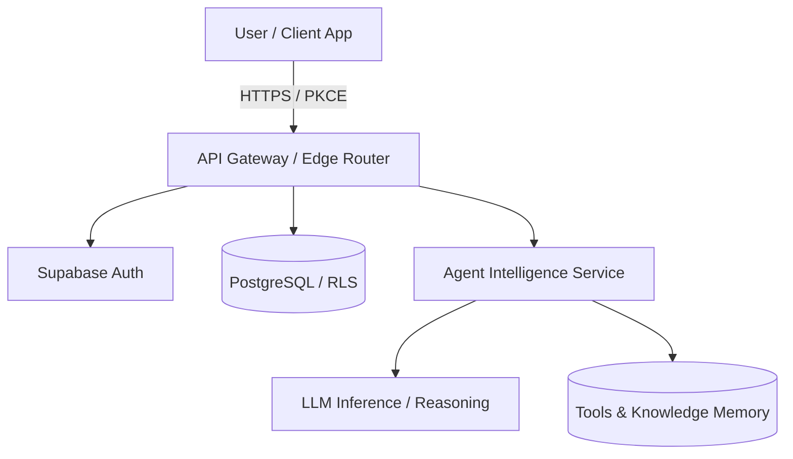
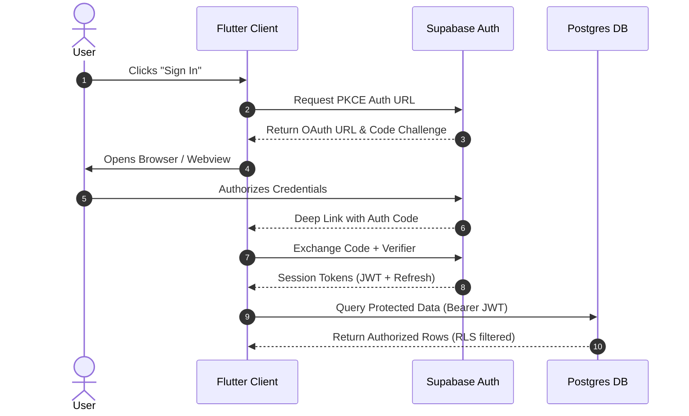
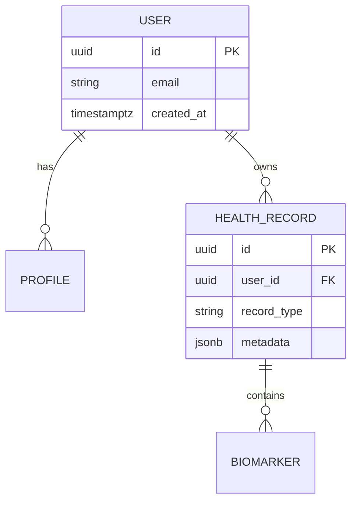

# Diagram Design & Architecture Visualization

This skill provides guidelines and templates for generating clear, high-density Mermaid diagrams, architecture maps, and system workflows.

---

## 1. Syntax Rules for Antigravity & Markdown

To prevent rendering errors in markdown viewers:
- **Quote labels containing special characters**: Use `id["Client (Browser)"]` instead of `id[Client (Browser)]`.
- **Avoid raw HTML in node text**: Use plain strings or Markdown formatting inside quoted strings.
- **Direction Flow**: Use `TD` (Top-Down) for deep pipelines or `LR` (Left-to-Right) for lifecycle states and sequences.

---

## 2. Diagram Templates

### Architecture & Service Flow (Flowchart)

### Authentication & Authorization Sequence

### Entity Relationship Diagram (ERD)

